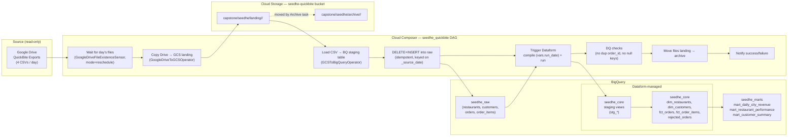

# QuickBite Capstone — seedhe

Incremental Drive → GCS → BigQuery raw → Dataform (staging/core) → BigQuery marts
pipeline, orchestrated by Cloud Composer (Airflow). All project/bucket/dataset
names are injected via Airflow Variables prefixed `seedhe_` — nothing is
hard-coded in the DAG or in Dataform.

Your config (fill in / confirm before first run):

| Thing | Value |
|---|---|
| GCP project | `sada-seed-2025-sandbox` |
| Composer environment | `composer-training` (region `us-central1`) |
| Dedicated capstone GCS bucket | `sada-seed-2025-sandbox-seedhe-quickbite` (created below — separate from the Composer environment's own bucket) |
| Drive folder (`QuickBite Exports`) | `1g1vo9hch93iJfagunWsCeBWwxtZFmxYk` |
| BigQuery datasets | `seedhe_raw`, `seedhe_core`, `seedhe_marts` |
| Dataform repository | `seedhe-quickbite` |

---

## 1. Architecture



---

## 2. Loading strategy per table

| Table | Strategy | Why |
|---|---|---|
| `raw.*` (all 4) | DELETE(`_source_date`=run_date) + INSERT, partitioned by `_source_date` | Each raw table is loaded via a throwaway staging table, then merged in with lineage columns (`_source_file`, `_source_date`, `_loaded_at`). Deleting the day's partition before inserting makes re-running a day a pure no-op — no duplicates. |
| `dim_restaurants` | **Replace** (`type: table`, full rebuild) | The file is a *full snapshot* every day — there's nothing to merge. Rebuilding from the latest snapshot each run is simpler and cheaper than diffing, and automatically "forgets" nothing (rule 3: inactive restaurants keep their history in `fct_orders`, they just get `is_active = false` in the dimension). |
| `dim_customers` | **Upsert** (`type: incremental`, `uniqueKey: customer_id`) | Day 0 = all customers, later days = new/changed only. A MERGE keyed on `customer_id` inserts new customers and overwrites existing ones with their current (latest `updated_at`) version — exactly rule 1. |
| `fct_orders` | **Incremental merge** (`type: incremental`, `uniqueKey: order_id`) | An order can appear in many files as its status changes; "current state wins" by `updated_at`, not by file. The staging view resolves the latest version per `order_id` across all history, but the core merge only touches orders whose *current* version was produced today (`_source_date = run_date`), so each run's BigQuery job stays small — satisfies "fct_orders must be incremental, not rebuilt from scratch". Invalid orders (rule 4) are filtered out via an `INNER JOIN` to `dim_restaurants` + `customer_id IS NOT NULL`, and routed to `rejected_orders` instead. |
| `fct_order_items` | **Append** (`type: incremental`, `uniqueKey: [order_id, line_no]`) | Items never change once placed, so there's nothing to update — but keying the merge on `(order_id, line_no)` makes a re-run of the same day idempotent instead of a raw, duplicate-prone `INSERT`. |
| `rejected_orders` | **Upsert** (`type: incremental`, `uniqueKey: order_id`) | Keeps one current reason per rejected order; if a previously-missing restaurant later appears, `fct_orders`'s `post_operations` deletes that order out of `rejected_orders` so the two tables stay mutually exclusive. |
| `mart_*` (all 3) | **Replace** (`type: table`, full rebuild) | Marts are small aggregates over `fct_orders`/`fct_order_items`/dimensions. Rebuilding them in full every run is cheap and guarantees they always reflect the *current* state of every order (e.g. if an order's status is corrected days later, the mart numbers move with it without needing a backfill job). |

---

## 3. Data quality log

Problems to expect/profile for (verify against the actual files once shared —
update this table with real findings before submission):

| # | File / Day | Problem | Handling |
|---|---|---|---|
| 1 | `orders_*` — all days | `status` arrives with inconsistent casing/separators (e.g. `"Out-of-Delivery"`, `"CANCELED"`) | Normalised in `stg_orders` via `lower/trim` + `regexp_replace` + explicit `CASE` mapping onto the exact 5 allowed values; unmapped values become `NULL` and are caught by the `nonNull` assertion on `fct_orders.status`. |
| 2 | `orders_*` | Missing/blank `payment_method` | Reported as `'unknown'` (rule 8) instead of `NULL`, via `coalesce(...,'unknown')`. |
| 3 | `orders_*` | Orders with `restaurant_id` not present in any `restaurants_*` snapshot | Excluded from `fct_orders`, written to `rejected_orders` with reason `unknown_restaurant_id` (rule 4). |
| 4 | `orders_*` | Missing `customer_id` | Excluded from `fct_orders`, written to `rejected_orders` with reason `missing_customer_id` (rule 4). |
| 5 | `order_items_*` | Zero/negative `quantity` or `unit_price` | Filtered out in `stg_order_items` (rule 5); never reach `fct_order_items` or revenue calculations. |
| 6 | `order_items_*` | Occasional duplicate `(order_id, line_no)` (e.g. accidental re-export) | De-duplicated in staging via `ROW_NUMBER() OVER (PARTITION BY order_id, line_no ORDER BY _loaded_at DESC)`, keeping one row per line (rule 5: "counts once"). |
| 7 | `restaurants_*` | `is_active` arrives as free text (`"true"/"1"/"yes"`/blank) | Normalised to BOOL in `stg_restaurants`, defaulting un-parseable values to `TRUE` so a restaurant is never silently hidden. |
| 8 | `customers_*` / `orders_*` | Same record's `updated_at` repeated verbatim across two files (no-op re-export) | Harmless — `ROW_NUMBER() ... ORDER BY updated_at DESC, _loaded_at DESC` still picks exactly one winner, and the merge overwrites with identical values. |
| 9 | `orders_*` | Unparseable `order_ts` / `updated_at` strings | `SAFE_CAST` to `DATETIME`/`TIMESTAMP` turns these into `NULL` rather than failing the whole load; `NULL updated_at` sorts last so it never wins against a dated version, and `NULL order_date`/`order_id` rows are caught by `nonNull` assertions. |

> Fill in exact file/day references and any additional findings (duplicate
> `restaurant_id`s within one snapshot, encoding issues, stray header-only
> files, etc.) once you've profiled the real files, before presenting.

---

## 4. Business answers (after processing through 2026-10-13)

Run these once the DAG has processed 2026-10-10 → 2026-10-13, then paste the
numbers here before submitting.

```sql
-- Total revenue across all dates
SELECT SUM(gross_revenue) FROM `seedhe_marts.mart_daily_city_revenue`;

-- Revenue per city, highest first
SELECT city, SUM(gross_revenue) AS revenue
FROM `seedhe_marts.mart_daily_city_revenue`
GROUP BY city ORDER BY revenue DESC;

-- Revenue on each of 2026-10-10..13
SELECT order_date, SUM(gross_revenue) AS revenue
FROM `seedhe_marts.mart_daily_city_revenue`
WHERE order_date BETWEEN '2026-10-10' AND '2026-10-13'
GROUP BY order_date ORDER BY order_date;

-- Top 5 restaurants by revenue
SELECT restaurant_id, restaurant_name, gross_revenue
FROM `seedhe_marts.mart_restaurant_performance`
ORDER BY gross_revenue DESC LIMIT 5;

-- Highest cancellation rate
SELECT restaurant_id, restaurant_name, cancellation_rate_pct
FROM `seedhe_marts.mart_restaurant_performance`
ORDER BY cancellation_rate_pct DESC LIMIT 1;

-- Repeat customers count
SELECT COUNTIF(is_repeat_customer) FROM `seedhe_marts.mart_customer_summary`;

-- Top 3 customers by spend
SELECT customer_id, total_spend
FROM `seedhe_marts.mart_customer_summary`
ORDER BY total_spend DESC LIMIT 3;
```

| Question | Answer |
|---|---|
| Total revenue (all dates) | _fill in_ |
| Revenue per city (highest first) | _fill in_ |
| Revenue on 10-10 / 10-11 / 10-12 / 10-13 | _fill in_ |
| Top 5 restaurants by revenue | _fill in_ |
| Highest cancellation rate | _fill in_ |
| Repeat customers (count) | _fill in_ |
| Top 3 customers by spend | _fill in_ |

---

## 5. How to run from scratch

### 5.1 One-time GCP setup

Run these yourself with your own `gcloud`/`bq` credentials (`gcloud auth
login` + `gcloud config set project sada-seed-2025-sandbox`) — I can't reach
your GCP project from this chat, so nothing below has been executed for you.

```bash
PROJECT_ID=sada-seed-2025-sandbox
REGION=us-central1
BUCKET=sada-seed-2025-sandbox-seedhe-quickbite      # dedicated capstone bucket
COMPOSER_ENV=composer-training
DATAFORM_REPO=seedhe-quickbite

# 1. Enable required APIs (idempotent if already on)
gcloud services enable \
  composer.googleapis.com \
  bigquery.googleapis.com \
  dataform.googleapis.com \
  drive.googleapis.com \
  storage.googleapis.com \
  --project="$PROJECT_ID"

# 2. Create the DEDICATED capstone bucket (separate from Composer's own bucket)
gcloud storage buckets create "gs://$BUCKET" \
  --project="$PROJECT_ID" --location="$REGION" \
  --uniform-bucket-level-access

# 3. Create the three BigQuery datasets
bq mk --project_id="$PROJECT_ID" --location="$REGION" --dataset seedhe_raw
bq mk --project_id="$PROJECT_ID" --location="$REGION" --dataset seedhe_core
bq mk --project_id="$PROJECT_ID" --location="$REGION" --dataset seedhe_marts

# 4. Create the Dataform repository + workspace
#    Easiest from the Cloud Console UI (no gcloud component needed):
#      Console -> search "Dataform" -> select project sada-seed-2025-sandbox
#      -> region us-central1 -> "CREATE REPOSITORY"
#        - Repository ID: seedhe-quickbite
#        - Leave "Connect to a remote git repository" unchecked for now
#      -> open the new repo -> "CREATE DEVELOPMENT WORKSPACE"
#        - Workspace ID: main
#
#    Equivalent via gcloud (the `dataform` command group lives under the
#    `beta` release track — install it once if gcloud reports
#    "Invalid choice: 'dataform'"; this only works from Cloud Shell/local
#    gcloud, not from the Console UI itself):
#      gcloud components install beta --quiet
#      gcloud beta dataform repositories create "$DATAFORM_REPO" \
#        --project="$PROJECT_ID" --region="$REGION"
#      gcloud beta dataform repositories workspaces create main \
#        --repository="$DATAFORM_REPO" --project="$PROJECT_ID" --region="$REGION"

# 5. Give the Composer environment's service account access to:
#    - the new bucket (object admin, to read/move/delete landing files)
#    - BigQuery (job user + data editor on the 3 datasets)
#    - Dataform (dataform editor, to trigger compilations/invocations)
COMPOSER_SA=$(gcloud composer environments describe "$COMPOSER_ENV" \
  --project="$PROJECT_ID" --location="$REGION" \
  --format="value(config.nodeConfig.serviceAccount)")

gcloud storage buckets add-iam-policy-binding "gs://$BUCKET" \
  --member="serviceAccount:$COMPOSER_SA" --role="roles/storage.objectAdmin"

gcloud projects add-iam-policy-binding "$PROJECT_ID" \
  --member="serviceAccount:$COMPOSER_SA" --role="roles/bigquery.dataEditor"
gcloud projects add-iam-policy-binding "$PROJECT_ID" \
  --member="serviceAccount:$COMPOSER_SA" --role="roles/bigquery.jobUser"
gcloud projects add-iam-policy-binding "$PROJECT_ID" \
  --member="serviceAccount:$COMPOSER_SA" --role="roles/dataform.editor"

# 6. Share the "QuickBite Exports" Drive folder with $COMPOSER_SA as Viewer
#    (do this in the Drive UI: Share -> paste $COMPOSER_SA email -> Viewer).
echo "Share the Drive folder with: $COMPOSER_SA"
```

Push the Dataform project (`dataform/` folder) into the `main` workspace of
the `seedhe-quickbite` repository (via the Dataform UI's git integration, or
`dataform install`/push from the Dataform CLI pointed at that workspace).

### 5.2 Airflow Variables (Composer)

Create a `seedhe_variables.json` (not committed with secrets — there are none
here, just config) and import it, or set one by one in the Airflow UI
(Admin → Variables):

```json
{
  "seedhe_project_id": "sada-seed-2025-sandbox",
  "seedhe_gcs_bucket": "sada-seed-2025-sandbox-seedhe-quickbite",
  "seedhe_drive_folder_id": "1g1vo9hch93iJfagunWsCeBWwxtZFmxYk",
  "seedhe_raw_dataset": "seedhe_raw",
  "seedhe_core_dataset": "seedhe_core",
  "seedhe_marts_dataset": "seedhe_marts",
  "seedhe_bq_location": "US",
  "seedhe_dataform_region": "us-central1",
  "seedhe_dataform_repository": "seedhe-quickbite",
  "seedhe_dataform_workspace": "main",
  "seedhe_file_wait_timeout_seconds": "21600",
  "seedhe_file_wait_poke_seconds": "600"
}
```

```bash
gcloud composer environments run "$COMPOSER_ENV" \
  --project="$PROJECT_ID" --location="$REGION" \
  variables import -- /home/airflow/gcs/data/seedhe_variables.json
# (upload seedhe_variables.json to the environment's GCS data/ folder first:
#  gcloud storage cp seedhe_variables.json gs://<composer-bucket>/data/)
```

### 5.3 Deploy the DAG

```bash
gcloud composer environments storage dags import \
  --project="$PROJECT_ID" --location="$REGION" \
  --environment="$COMPOSER_ENV" \
  --source=airflow/seedhe_quickbite.py
```

The DAG starts **paused** by default in most Composer setups — unpause it in
the Airflow UI only while you're actively working on it (ground rule).

### 5.4 Run it

* Trigger/enable the DAG — with `start_date=2026-10-10`, `schedule=@daily`
  and `catchup=True`, Airflow will back-fill runs for 2026-10-10, 11, 12, 13
  in order (`max_active_runs=1` keeps them sequential).
* Each run's `{{ ds }}` (logical date) drives which 4 Drive files it waits
  for, loads, and which Dataform `run_date` var it compiles with.
* When the live file is dropped during assessment, the DAG needs **no code
  change** — the next scheduled run (or a manually triggered run for that
  date) just works, because every file/table/var reference is parameterised
  on `ds`.

### 5.5 Verify before submitting

* All 4 runs green in the Airflow UI (Grid view).
* Re-trigger any one historical run (e.g. 2026-10-11) via "Clear" — mart
  numbers in BigQuery must not change (idempotent raw merge + incremental
  Dataform models keyed on business keys).
* `SELECT order_id, COUNT(*) FROM seedhe_core.fct_orders GROUP BY 1 HAVING COUNT(*) > 1`
  returns 0 rows.


